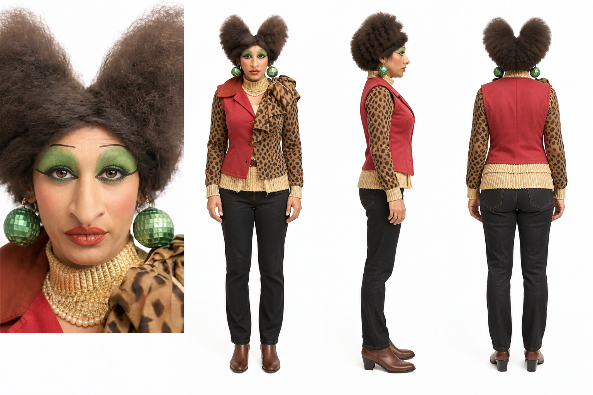
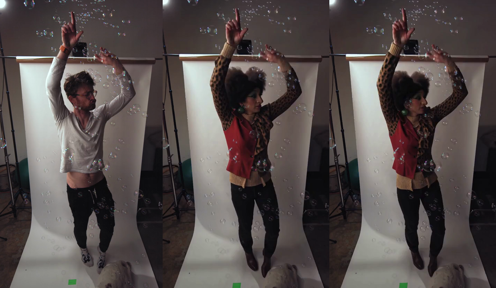
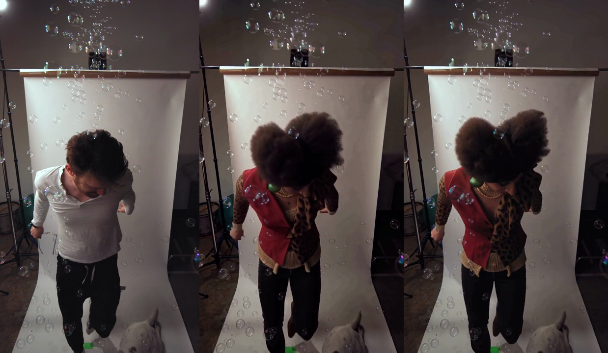

# Viggle Remake: long takes for ComfyUI

A ComfyUI custom node for rendering a continuous Viggle Remake swap across multiple bounded MiniMax H3 renders. This repository provides a baseline long-video node and an experimental context-protection variant.

## Contents

- `nodes.py` and `__init__.py`: the custom nodes. They use helper classes from the separately installed official Viggle Remake package.
- [`workflows/viggle-body-swap.json`](workflows/viggle-body-swap.json): the example workflow, with its prompt and reference-image node already set up.
- `images/`: the character reference sheet and first/last-frame comparisons shown below.

## Install

Install the official `ComfyUI-Viggle-Remake` custom node first. Then clone this repository directly inside `ComfyUI/custom_nodes/` and restart ComfyUI:

```bash
cd ComfyUI/custom_nodes
git clone https://github.com/hojenaia/viggle-remake-comfyui-long-take.git
```

The official Viggle Remake package provides the original Conditioning, Keyframe Until, and Noise nodes; this repository registers **Viggle Remake Long Video** and **Viggle Remake Long Video (Context Protection)**. The model files and source video are not included.

## Reproduce the example

The source is the **720p version** of [A man standing in front of a white background with bubbles on Pexels](https://www.pexels.com/video/a-man-standing-in-front-of-a-white-background-with-bubbles-20218504/), converted to 24 fps. Download it and place it in `ComfyUI/input/` as `20218504-hd_720_1280_24fps.mp4`.

The character reference sheet is included in this repository. Copy it to `ComfyUI/input/` using the filename expected by the workflow, then open [`workflows/viggle-body-swap.json`](workflows/viggle-body-swap.json). The workflow already contains the complete prompt and the reference-image connection.



## Comparison frames

These are the first and last frames from the 1:23 test. In each comparison, the **left** panel is Context Protection, the **center** panel is the original long-video node, and the **right** panel is the source video.

**First frame**



**Last frame**



## Inputs and limits

Connect the MiniMax H3 model with the Viggle Remake LoRA, CLIP, video and audio VAEs, sampler, sigmas, source frames, and character reference images. Audio is optional; without it, the output is silent. `window_frames` defaults to 294 and can be raised to 345 if the GPU has enough memory. Source footage must be 24 fps. The nodes are intended for one continuous shot; they do not detect cuts or rewrite timestamped prompt instructions. Describe actions without absolute timestamps.

## Viggle Remake Long Video

MiniMax H3 limits each render to a bounded number of frames. For a longer continuous take, this node renders overlapping windows. It carries the previous window's final **17 frames** into the next window as locked VAE latents, then removes those overlap frames when joining the windows. This gives each new render recent visual and motion context at the seam while keeping the output duration correct. This follows the long-take method described in the [Viggle Remake ComfyUI documentation](https://huggingface.co/Viggle/Viggle-Remake/blob/main/COMFYUI.md#long-continuous-takes-experimental).

The 17-frame handoff is local to the immediately preceding window. Small changes in appearance or background can therefore become the reference for the following window and accumulate over a long chain. The original node preserves this overlap behavior without adding global anchors.

## Viggle Remake Long Video (Context Protection)

This experimental variant keeps the same 17-frame handoff and uses a fixed keystone and capstone from the first rendered window. The approach is informed by the frame-zero and keystone/capstone experiments documented in [NerdNotes](https://github.com/roycho87/NerdNotes/blob/main/20261101/frame0_conclusions.md) and the context techniques explored in [Geiru Context Suite](https://github.com/roycho87/geiru_context_suite).

- **Keystone** reuses the first window's first video latent as the first latent of the overlap in every later window. That overlap is locked and discarded at the join, so this provides a stable visual anchor without adding a frame to the output.
- **Capstone** temporarily appends a latent from near the end of the first window as locked context in later windows. The same clean anchor is reused throughout the chain and trimmed from each model output before decoding, so it is not part of the finished video.

The keystone is intended to keep the start-of-window appearance from drifting as the chain grows. The capstone supplies a stable far-end reference. The original Geiru implementation delays adding the capstone until a later denoising step because locking it from the beginning can pull the generated pose toward the capstone. This node follows that **Late Lock** idea: `capstone_start_step` defaults to 4, so with six sampler steps the capstone is used only for the final two. Keystone and capstone are enabled by default in the Context Protection node; capstone can be disabled for comparison. The fixed capstone with Late Lock is experimental and needs local render validation.

This node is an independent integration inspired by the published experiments; it does not copy the Geiru Context Suite implementation. Thanks to **@roycho87** for sharing the research and ComfyUI projects that informed this approach: [NerdNotes](https://github.com/roycho87/NerdNotes) and [Geiru Context Suite](https://github.com/roycho87/geiru_context_suite).

## Status

Experimental. Review identity, background detail, and motion continuity at every window seam.

## License

Apache-2.0. See `LICENSE`.
